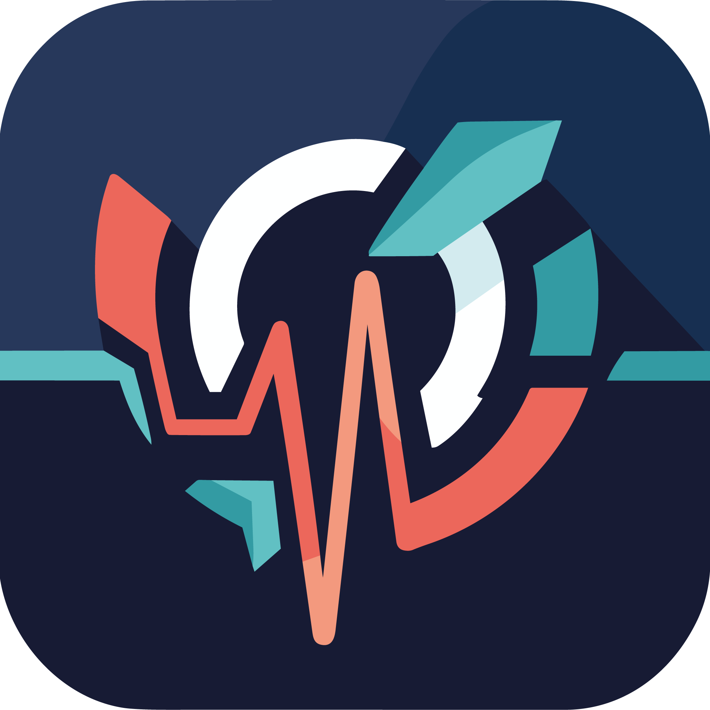

<p align="center">
  
</p>

# OpenClaw Coach

An endurance and recovery coach plugin for [OpenClaw](https://github.com/openclaw/openclaw), built on
[garmin-cli](https://github.com/sctg-development/garmin-cli) (the `gc` CLI for Garmin Connect).

Version 2 is a rewrite. Version 1 handed raw Garmin payloads to the model; version 2 **computes documented
physiological models in code** and gives the model compact, sourced results to interpret:

- **HRV** against the athlete's own baseline (ln rMSSD, 7-day trend, normal range, stability);
- a **recovery index** and its components (HRV, resting heart rate, sleep, respiratory rate, skin temperature);
- **early-warning** flags when several signals move together;
- **sleep** sufficiency, running debt and regularity;
- **training load** (Banister TRIMP, fitness, fatigue, form, monotony, intensity distribution) with
  **projection of a plan**;
- a daily **training ceiling** (rest / easy / moderate / hard) with the rules behind it;
- activity analysis (grade-adjusted pace, aerobic decoupling), zones and paces, strength summaries,
  a habit journal with association statistics, long-term health markers.

Every formula, constant, threshold, level of evidence and limit is in
[`docs/SCIENCE.md`](docs/SCIENCE.md) (written for review by sport-science and medical teams,
with a verified bibliography and LLM recommendations). The coaching behaviour and safety rules are in
[`skills/coach/SKILL.md`](skills/coach/SKILL.md).

This is a coaching aid for a healthy training adult. It is not a medical device and makes no diagnosis.

## Requirements

- An OpenClaw Gateway (2026.8.2+).
- [`gc`](https://github.com/sctg-development/garmin-cli) **0.4.0 or later** (for `gc daily`), installed
  and authenticated in the environment the Gateway runs in: sign in with `garmin-ts login` (it handles multi-factor
  codes); `gc login` is only a last resort if Garmin refuses the native sign-in.

## Install

```bash
openclaw plugins install npm:@sctg/openclaw-coach
```

## Set up

1. Check that `gc status` succeeds in the Gateway's environment.
2. Configure the athlete's anchors (see Configuration). At least `timezone`, `sex` and a measured `hrMax`.
3. Ask the coach to run `coach_data_status` with `sync: true`: it fetches 90 days of recovery signals and
   180 days of activities (about 25 Garmin requests), and says what is missing.
4. Create `ATHLETE.md` (and, when you want the coach to follow a plan, `PLAN.md`) in the agent's workspace: see
   [Workspace files](#workspace-files).
5. Optionally schedule check-ins with OpenClaw Automations (recipes in the skill).

Baselines need history: HRV and recovery are `calibrating` until 14 nights exist, and the load model
needs about a month to be usable and three months to be stable.

## Workspace files

The coach computes from your watch data; what the watch cannot know (your goal, injuries, constraints,
availability, the plan) lives in two plain Markdown files in the **agent's workspace**, which the coach reads
at the start of its routines.

| File | Required | Who writes it | Role |
|---|---|---|---|
| `ATHLETE.md` | Strongly recommended | You, once, then when your situation changes | Bio, measured anchors, goal, injury and medical history, **binding constraints**, availability, preferences |
| `PLAN.md` | Optional | The coach (you can edit it too) | Phases, the next 7 days, adjustment rules, log of changes |

Examples with a fictional athlete are in [`examples/ATHLETE.md`](examples/ATHLETE.md) and
[`examples/PLAN.md`](examples/PLAN.md). The constraints in `ATHLETE.md` are never overridden by the coach or
by a model output; symptoms always come before signals.

### Where they go

The workspace is `~/.openclaw/workspace/` of the user running the Gateway (`agents.defaults.workspace`
can move it). In the OpenClaw container image this is
`/home/node/.openclaw/workspace/`, on the persistent volume:

```text
~/.openclaw/workspace/ATHLETE.md
~/.openclaw/workspace/PLAN.md
```

### How to create them

1. **With the coach (simplest).** Say: "Create my ATHLETE.md; ask me the questions you need, one block at a
   time, and show it to me before saving." The coach follows the template in
   [`skills/coach/SKILL.md`](skills/coach/SKILL.md). For `PLAN.md`, give your goal and availability and ask
   for a plan; the coach projects it with `coach_training_load` before saving it.
2. **By hand.** Copy the examples and replace every value:

   ```bash
   cp examples/ATHLETE.md ~/.openclaw/workspace/ATHLETE.md
   cp examples/PLAN.md    ~/.openclaw/workspace/PLAN.md
   ```

   On a Kubernetes deployment, copy into the pod instead
   (`kubectl cp ATHLETE.md <namespace>/<pod>:/home/node/.openclaw/workspace/ATHLETE.md -c gateway`).
3. **Seeded by the Helm chart** (`sctg-claw`): put the content under `openclaw.workspaceFiles.ATHLETE.md` in
   your **private** values. The init container copies it on first boot only (an existing file on the volume
   is kept), so later edits are made in the workspace, not in the values. Do not put health data in a public
   chart.

Tips: keep `ATHLETE.md` under about one page (it is sent to the LLM provider in every session, see
[Data and privacy](#data-and-privacy)); write measured values with how and when they were measured; put every
restriction in *Current constraints* as an instruction ("no ...", "at most ..."), with the date of the next
review; remove a constraint only when the person who set it lifts it. Also set `hrMax` and `lthr` in the plugin
configuration: the files are for the coach, the configuration is for the models.

## Tools

| Tool | Purpose | Writes |
|---|---|---|
| `coach_daily_briefing` | Ceiling for the day, recovery, HRV, sleep, early warning, load, yesterday's sessions | local store |
| `coach_trends` | Weekly aggregates, load indicators, long-term health markers | local store |
| `coach_training_load` | Load model and projection of a plan | local store |
| `coach_activity_deep_dive` | One activity: laps, grade-adjusted pace, decoupling, heat | — |
| `coach_zones_and_paces` | Heart-rate zones, VDOT paces, race equivalences | — |
| `coach_strength_analysis` | One strength session: volume, estimated 1RM | — |
| `coach_journal_log` | Subjective check-in, symptoms, habits (at most 24 tags per day and 60 distinct tags overall) | local journal |
| `coach_journal_insights` | Associations between habits and the following night (at most 20 habits compared per call; the rest are listed as `skipped`) | — |
| `coach_briefing_email` | Build the whole daily e-mail (subject, HTML, text, inline images), ready for any mail tool | PNG files in `dataDir/charts` |
| `coach_briefing_charts` | Render the day's figures as PNG images (gauge, ceiling, signals, HRV, load, sleep) for an email | PNG files in `dataDir/charts` |
| `coach_workout_push` | Create a workout in Garmin Connect (preview, then explicit confirmation) | **Garmin Connect** |
| `coach_data_status` | Coverage, sync errors, anchors in use | local store |

Version 1's `coach_garmin_digest` is gone: replace it with `coach_daily_briefing` in existing automations.

## Configuration

| Key | Default | Description |
|---|---|---|
| `garminBackend` | `auto` | `native`: fetch in the Gateway process with [`@sctg/garmin-ts-client`](https://github.com/sctg-development/garmin-ts-client); `gc`: the garmin-cli binary; `auto`: native when the package and a token file are present, else gc. Creating workouts always uses `gc`. |
| `garminTokenFile` | `$GARMINTOKENS` or `~/.config/garmin-cli/tokens/garmin_tokens.json` | Token file of the native backend (the file `gc login` or `garmin-ts login` writes). |
| `gcBinary` | `gc` | Path to the garmin-cli binary. |
| `timezone` | Gateway timezone | IANA timezone of the athlete (day boundaries). |
| `dataDir` | `~/.openclaw/coach` | Local store directory. |
| `sex` | — | `male` or `female`: training-load coefficients. |
| `birthYear` | — | Only used to estimate maximum heart rate when none is measured. |
| `hrMax` | observed, else age formula | Measured maximum heart rate (bpm). Strongly recommended. |
| `hrRest` | 60-day median | Resting heart rate (bpm). |
| `lthr` | Garmin's estimate | Lactate-threshold heart rate (bpm). |
| `sleepNeedHours` | `8` | Used when Garmin reports no personal sleep need. |
| `hrZoneFloorsPctMax` | `[50,60,70,80,90]` | Lower bound of zones 1-5, in percent of maximum heart rate. |
| `historyDays` | `90` | Days of recovery history kept in sync. |
| `loadHistoryDays` | `180` | Days of activities used by the load model. |
| `retentionDays` | `730` | Older stored data is deleted. |
| `cacheMinutes` | `15` | Minimum delay between two fetches of recent days. |
| `language` | `en` | Language of the chart labels: `en` or `fr`. |
| `allowWorkoutPush` | `false` | Allow `coach_workout_push` to write to Garmin Connect. |

```json5
{
  plugins: {
    entries: {
      coach: {
        config: { timezone: "Europe/Paris", sex: "male", birthYear: 1975, hrMax: 182 },
      },
    },
  },
}
```

## Charts for emails

`coach_briefing_charts` draws the day's figures as PNG images, from the same model results as
`coach_daily_briefing` (it computes nothing of its own):

| Chart id | Size (px) | Shows |
|---|---|---|
| `recovery_gauge` | 280 x 210 | Recovery index 0-100 on a three-band gauge |
| `ceiling` | 280 x 210 | Today's ceiling (rest / easy / moderate / hard) and the suggested load |
| `signals` | 600 x 246 | Last night's HRV, resting heart rate, respiration, skin temperature and SpO2 against your own usual range |
| `hrv_trend` | 600 x 260 | 28 nights of HRV, the 7-day trend and the personal normal range |
| `load_curve` | 600 x 350 | 8 weeks of fitness (CTL), fatigue (ATL) and form (TSB) |
| `sleep_nights` | 600 x 260 | 14 nights, stacked by stage, against the sleep need |

Images are rendered at twice their display size (sharp on high-density screens) with a bundled font
([Inter](assets/fonts/LICENSE.txt), SIL OFL), so the output does not depend on the fonts of the host. A chart
without enough data is skipped with the reason. Parameters: `charts` (subset), `lang` (`en` or `fr`, default
the `language` setting), `theme` (`light` or `dark`, default `light`: an email keeps its own opaque card).
Files are written to `<dataDir>/charts/<date>/<id>.png` (owner-only permissions) and folders older than 14
days are deleted.

To put them **inside** an email, the mail tool must send them as inline images: with the `sctg-mail`
plugin's `send_email`, pass each chart as `inlineImages: [{ cid, path }]` and reference it in the HTML:

```html
<table role="presentation" width="600" cellpadding="0" cellspacing="0"><tr>
  <td width="300"></td>
  <td width="300"></td>
</tr></table>

```

The tool result already contains, for each chart, the `cid` (`coach-<id>`), the `path`, the display size and a
ready-made `alt` text. `send_email` only reads image files from `~/.openclaw/coach/charts` (configurable with
its `inlineImageRoots`), refuses anything that is not a real PNG or JPEG, and falls back to a text-only
rendering on channels that cannot carry inline images. Always write the `alt` text: many mail clients block
images until the reader allows them.

## Daily briefing e-mail

`coach_briefing_email` builds the whole message in code: subject, HTML (one centred 600 px column, ceiling
banner, recovery gauge and ceiling side by side, "why", signals, HRV, sleep, "to watch", a text summary table,
footer), a plain-text version and the list of inline images. The layout does not depend on the model, so a
small model produces the same mail as a large one. It sends nothing: pass `subject`, `bodyHtml`, `bodyText`
and `inlineImages` to any mail tool that supports inline images by content id (`send_email` of the
`sctg-mail` plugin does; with a tool that does not, send `bodyText` alone, the key figures are in it).

The model only writes the three sentences that need judgement, in the athlete's language: `headline` (what to
do today, with `ATHLETE.md` and `PLAN.md` in mind), `why` (up to 3 bullets) and `watch` (up to 4 cautions).
Left out, `headline` defaults to the meaning of the ceiling in the chosen language; `why` and `watch` default to the
rules and caveats of the models, which are in English, so they are used for English mails only and the sections
are omitted for French (the result's `notes` say so). Always pass all three; pass `watch: []` when there is nothing to watch. The fitness curve
is added on Sundays (`weekly: true` forces it).

Minimal automation prompt:

```text
Read ATHLETE.md and PLAN.md. Call coach_briefing_email with lang "fr", then write headline (one sentence: what
to do today, given my constraints), why (up to 3 bullets with figures and my personal reference) and watch
(cautions only), using only figures from coach_daily_briefing, and call coach_briefing_email again with them.
Send the result unchanged with send_email to <my address>: subject, bodyHtml, bodyText, inlineImages.
If the briefing is an error, send a short text mail instead. Reply only "sent" or the error.
```

Create the job as an **isolated agent turn** with delivery disabled, because the mail leaves through
`send_email`, not through a chat channel:

```bash
openclaw cron add --name "Briefing entrainement" --cron "0 10 * * *" --tz Europe/Paris \
  --session isolated --no-deliver --message "$(cat briefing-prompt.txt)"
```

(The exact flags depend on your OpenClaw version: check `openclaw cron add --help`. To change an existing
job, use `openclaw cron edit <id> --message ...`.) A job that runs in the *main* session does not receive the
plugin's tools reliably: use an isolated one.

### Custom layout: the full prompt

If you want to control the HTML yourself, the model can assemble it from `coach_daily_briefing` and
`coach_briefing_charts` instead. The prompt below is the one used for the sample result. It is shown in English; the original is in French
and the e-mail is written in the language you ask for (`lang` of `coach_briefing_charts`, or the plugin's
`language` setting). Replace `<my address>` before using it.

<details>
<summary>The prompt</summary>

```text
You are the coach. Send me the morning briefing by e-mail, as HTML with charts.

DATA
1. Read ATHLETE.md (goals, constraints, injuries) and PLAN.md if it exists.
2. Call coach_daily_briefing. Use only its fields: do not invent any figure, nor any physiological or
   nutritional advice that is not in it. A null field means "not measured": do not mention it, or write "n/a".
3. If the briefing is an error, or if a block has a status other than "ready" with no usable explanation,
   send a short mail saying so, without charts, instead of making things up.
4. Call coach_briefing_charts with lang "fr" and sync false. Use only the charts it returns (a "skipped"
   chart has no file: do not reference it).

E-MAIL
One message, sent with send_email:
- to: <my address>
- subject: "Briefing du <weekday> <date> : <ceiling>" (rest = Repos, easy = Facile, moderate = Modéré,
  hard = Intense)
- bodyHtml: the HTML described below
- bodyText: short version, no Markdown (ceiling, one sentence, the 3 key figures)
- inlineImages: [{cid, path}] for EVERY chart used, exactly as returned by the tool. Each cid must appear
  in the HTML as src="cid:CID".

HTML STRUCTURE (inline CSS only, column of at most 600 px, system font, white background, no script, no
external image, tables for layout, horizontally centred, working on mobile and desktop)
1. Banner with today's ceiling: white text on a coloured background (Repos #64748b, Facile #d97706,
   Modéré #2563eb, Intense #16a34a), then ONE sentence of at most 20 words saying what to do today, taking
   the constraints of ATHLETE.md and PLAN.md into account.
2. A table of 2 cells of 300 px: recovery_gauge | ceiling (image width 280).
3. "Why": at most 3 bullets, main cause first, with the figures and their personal reference
   (e.g. "7-day HRV: 29 ms, your normal range: 31-34 ms").
4. Image signals (width 600).
5. Image hrv_trend, then sleep_nights (width 600).
6. Image load_curve (width 600) on Sundays only.
7. "To watch": only the warnings of the briefing (early warning, symptoms, sleep debt, load, missing
   data). Factual, calm tone: no shouting capitals, no "imperative".
8. A small 3-row table, in text (images are not displayed by every client):
   - Sleep: duration / need, efficiency, bedtime and wake-up
   - Yesterday's session: type, duration, average heart rate, load
   - Load: CTL, ATL, TSB, change over 7 days
9. Footer: "Tell me how you feel (fatigue, pain, motivation)" + "This message is a training aid, not
   medical advice."

EACH IMAGE

with CID, W (displayWidth, or 280 in the 2-cell table) and ALT taken from the tool result.
Also keep the key figures in the text: images may be blocked by the mail client.

STYLE
Informal "you" (tutoiement), French, short sentences, no emoji, no list of generic advice, no figure that
does not come from the tools.

Reply only "envoyé" or the error met. If send_email returns degraded: true, say so.
```

</details>

How the prompt is built, and why:

- **Data first, then charts.** The model reads the athlete's context, calls `coach_daily_briefing`, and only
  then asks for charts. A failed or incomplete briefing produces a short text mail instead of invented numbers.
- **Nothing is computed by the model.** Every figure comes from a tool result; `null` means "not measured".
  Charts are drawn from the same results (see "Charts for emails").
- **One `send_email` call** carries the HTML, a plain-text alternative and the `inlineImages` list. Each `cid`
  returned by `coach_briefing_charts` must be referenced as `src="cid:CID"` in the HTML.
- **Layout rules** are explicit (table layout, inline CSS, 600 px column, centred) because mail clients ignore
  most modern CSS. Ceiling colours match the charts. The key figures are repeated as text, since many clients
  block images by default.
- **The load curve** is only added on Sundays to keep the daily mail short.

First run: execute the job once by hand and check the received mail. If `send_email` reports
`degraded: true`, the images were replaced by their alt text (see `skills/sctg-mail`).

## Sample result

Sent by an automation using the prompt above, with `Mistral Medium 3.5` as the model.
A raw, anonymised copy of the message is in
[`sample-output-mistral-medium-3-5.eml`](sample-output-mistral-medium-3-5.eml).

<p align="center">
  
</p>

## Data and privacy

The plugin keeps a single JSON file (`coach-store.json`, owner-only permissions) with nightly aggregates,
the activity list and the journal: no intraday series, no GPS tracks, no credentials. Delete the file to
erase everything. Tool results, the journal and `ATHLETE.md` are sent to whichever LLM provider the
Gateway uses: that is health data, so choose the provider accordingly (see `docs/SCIENCE.md`, section 10).

## Development

```bash
npm ci
npm run typecheck
npm test          # 46 tests, synthetic data, no Garmin access needed
npm run build
```

The models are pure functions in `src/science/`; `src/tools.ts` takes its `gc` runner and clock as
arguments, so tests run against a fake `gc`. When a formula, constant or threshold changes, bump the
model's `version` and update `docs/SCIENCE.md` in the same commit.

To check which fields your watch and account return, without exposing any value:

```bash
gc daily yesterday --keys
```

## Publishing

`.github/workflows/publish.yml` publishes to npm when a GitHub Release is published. It checks that
`package.json`'s version matches the release tag (`vX.Y.Z`).

## License

MIT — see [LICENSE](LICENSE). The logo files in `assets/` (`logo.ai`, `logo.svg`, `logo.png`) are
copyright SCTG Development and licensed under CC BY-SA 4.0, not MIT. The Inter fonts keep their own
licence (`assets/fonts/LICENSE.txt`).
